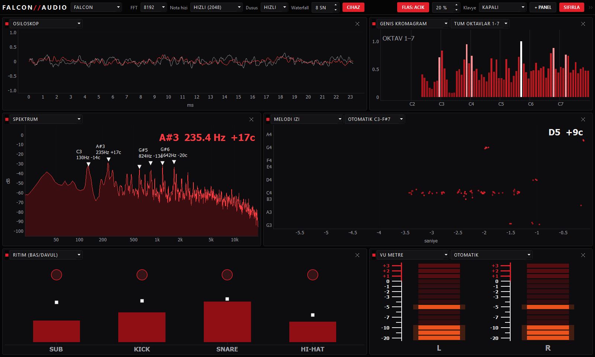
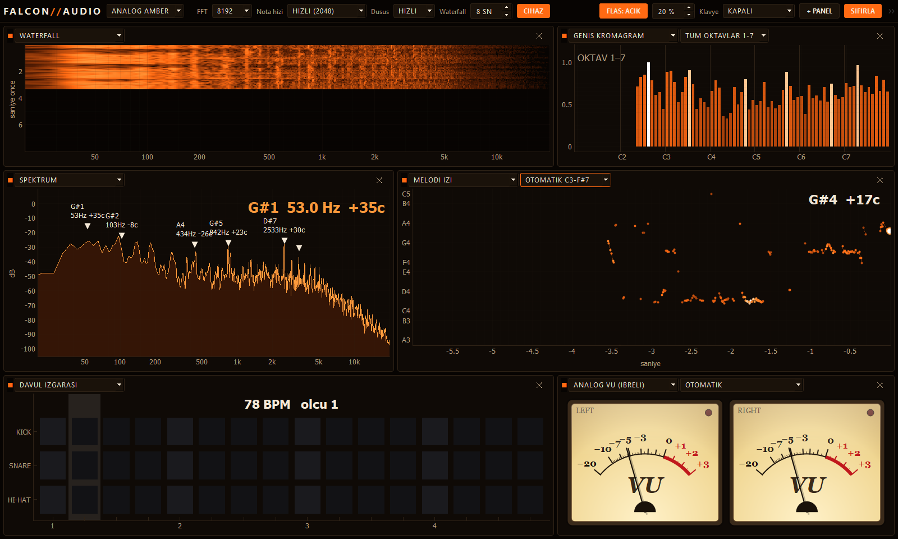

# FALCON//AUDIO

Bilgisayarda çalan sesi (Spotify, YouTube, oyun… ne çalarsa) ya da mikrofonu **gerçek zamanlı** görselleştiren masaüstü uygulaması. Tek Python dosyası, Windows.



## Özellikler

**16 görünüm.** Ekranda 6 panel var. Her panelin üstündeki menüden görünüm seçilir. Paneller sürüklenerek boyutlandırılır, ✕ ile kapatılır.

| Görünüm | Ne gösterir |
|---|---|
| Osiloskop / CRT Osiloskop | Tetiklemeli dalga şekli. CRT sürümünde yeşil fosfor ve önceki taramaların sönerek kalan izi |
| Spektrum | 20 Hz – 20 kHz, tepe notaları cent hassasiyetiyle işaretli |
| LED Spektrum (31 bant) | Eski hi-fi grafik analizörü: 1/3 oktav, tepe tutmalı LED'ler |
| Waterfall | Zaman-frekans haritası |
| Kromagram / Geniş Kromagram | 12 notanın ağırlığı ve akor tahmini (majör, minör, 7, m7). Geniş sürüm 7 oktavı yan yana gösterir |
| Nota × Oktav | C1–B7 ısı haritası, tepe notalar beyaz |
| Melodi İzi | Saniyede 100 ölçümle baskın perde. Vibrato hızı ve derinliğini gösterir, oktav aralığı panel başına seçilir |
| Oktav Sarmalı / Oktav Enerjisi | Notaların oktav sarmalı üzerinde animasyonu |
| Ritim / Davul Izgarası / Davul İzi | Kick, snare ve hi-hat algılama, BPM, 16 adımlık davul kalıbı ve zaman çizelgesi |
| VU Metre / Analog VU | LED ya da ibreli VU. Referans seviyesi seçilebilir ya da otomatik |

**Diğer:**
- 6 tema: Falcon, Analog Amber, Neon Cyan, Fosfor Yeşil, Synthwave, **Retro Analog**
- Kick vuruşunda pencere kenarlarında parlama
- **ASUS TUF klavye RGB:** Klavye ışığı kick'e, notaya ya da ses seviyesine tepki verir. Sadece ASUS TUF laptoplarda çalışır, diğer bilgisayarlarda kendini kapatır.

| Retro Analog | Neon Cyan | Analog Amber |
|---|---|---|
|  |  |  |

## Kurulum

Gereken: **Windows 10/11** ve **Python 3.9+**. Bilgisayarda çalan sesi yakalamak için WASAPI loopback kullanıldığından program macOS ve Linux'ta çalışmaz.

```
pip install -r requirements.txt
python scope.py
```

Açılışta ses kaynağı seçilir. 🔊 işaretliler bilgisayarda çalan ses, 🎤 işaretliler mikrofon. Kaynak sonradan **CİHAZ** düğmesiyle değiştirilebilir.

Tema yazı tipi [Chakra Petch](https://fonts.google.com/specimen/Chakra+Petch) (Google Fonts). Yüklü değilse Segoe UI kullanılır.

## Bilinen sınırlar

- Melodi ve akor algılama tam bir mikste yaklaşıktır. Vokal ile enstrümanlar karışabilir. Sade vokal ya da solo kayıtlarda daha temiz sonuç verir.
- 170+ BPM'lik şarkılarda tempo yarısı olarak gösterilebilir.
- C1 ile ~D#2 arasındaki notalar FFT çözünürlüğü yetmediği için gösterilmez.
- Klavye RGB özelliği belgelenmemiş bir ASUS arayüzünü kullanır, Armoury Crate ile çakışabilir.

## Test modu

`SCOPE_AUTOTEST=1` ortam değişkeni ayarlıysa program cihaz seçme penceresini atlar ve 5 saniye sonra kendini kapatır. Otomatik testler için kullanılır.
