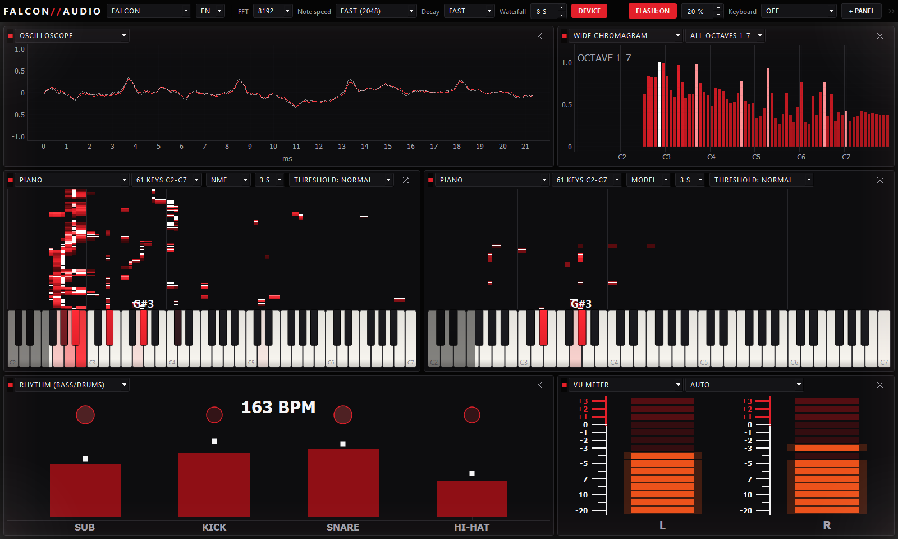
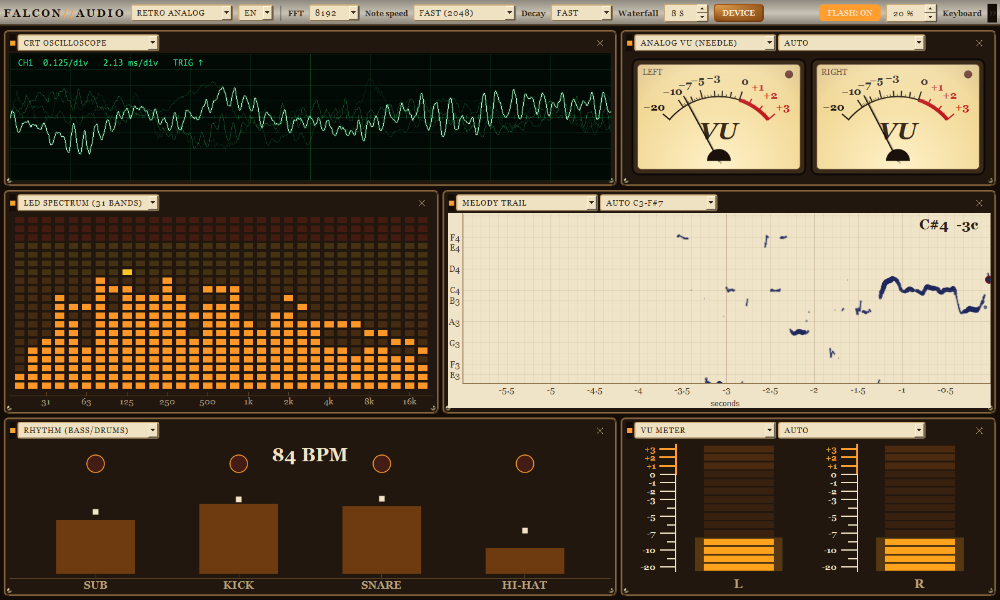
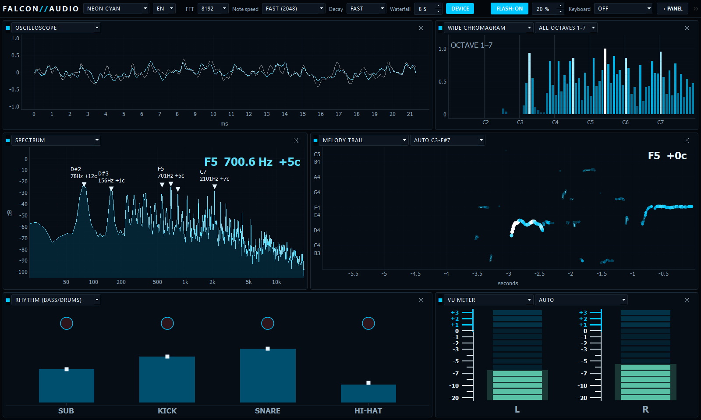

# FALCON//AUDIO

**English** | [Türkçe](README.tr.md)

A desktop app that visualizes whatever your computer is playing (Spotify, YouTube, games…) or your microphone, **in real time**. A single Python file, Windows only.


## Features

**20 views.** The window has 6 panels. Pick a view from the menu at the top of each panel. Drag the borders to resize panels, and close them with ✕.

| View | What it shows |
|---|---|
| Oscilloscope / CRT Oscilloscope | Triggered waveform. The CRT version has green phosphor with fading traces of earlier sweeps |
| Spectrum | 20 Hz – 20 kHz, with peak notes labeled to the cent |
| LED Spectrum (31 bands) | Classic hi-fi graphic analyzer: 1/3 octave bands with peak-hold LEDs |
| Waterfall | Time-frequency map |
| Chromagram / Wide Chromagram | Weight of the 12 notes plus a chord guess (major, minor, 7, m7). The wide version shows 7 octaves side by side |
| Note × Octave | C1–B7 heat map, strongest notes in white |
| Melody Trail | Dominant pitch measured 100 times a second. Shows vibrato rate and depth. Octave range is set per panel |
| Octave Spiral / Octave Energy | Animated notes on an octave spiral |
| Rhythm / Drum Grid / Drum Trail | Kick, snare and hi-hat detection, BPM, a 16-step drum pattern and a timeline |
| VU Meter / Analog VU | LED or needle VU. Reference level is selectable or automatic |
| **Piano** | Playing notes light up on a keyboard while a piano roll scrolls above it. Choose from 4 detection modes (below), the key range (37–88 keys), roll speed (1–8 s) and trigger threshold. Fast repeated presses of the same key show up separately |
| Spotify | Current track, cover art, progress and play/pause/next/previous. Needs the Client ID of your own Spotify Developer app (below) |
| Media | Track info and controls for any Windows app playing media (browsers, YouTube Music, VLC…) |
| Window Capture | Live view of a chosen app window (e.g. the video in Spotify) |

### Piano detection modes

| Mode | How it works | Best for |
|---|---|---|
| **NMF** (default) | Solves the spectrum as a sum of the notes' harmonic templates | Instant response. F1 0.98 on a synthetic chord test |
| **Model** | Spotify's open-source [basic-pitch](https://github.com/spotify/basic-pitch) neural network (ONNX). Processes the last 2 s of audio ~12 times a second | Cleanest result on real recordings, including bass notes. Needs an optional install |
| Filter | Simple peak filter that drops harmonics | Lightweight |
| Raw | Every semitone peak | Debugging |



**Also:**
- **Picks up where you left off:** Window size, panels, each panel's settings, theme and audio device are saved to `~/.falcon_audio/state.json` on exit (and every 10 seconds). If the last device is still connected, the app starts without asking. Delete that file to start fresh.
- **English / Turkish interface:** Switch with the EN / TR menu in the top bar. The app restarts with the same layout. On first launch it follows the Windows language.
- 6 themes: Falcon, Analog Amber, Neon Cyan, Phosphor Green, Synthwave, **Retro Analog**
- Window edges glow on each kick drum hit
- **ASUS TUF keyboard RGB:** The keyboard lighting reacts to the kick, the notes or the volume. Works only on ASUS TUF laptops and turns itself off elsewhere.

| Retro Analog | Neon Cyan | Analog Amber | Synthwave: drum views |
|---|---|---|---|
|  |  |  |  |

## Installation

Requires **Windows 10/11** and **Python 3.9+**. Capturing what the computer plays uses WASAPI loopback, so the app does not run on macOS or Linux.

```
pip install -r requirements.txt
python scope.py
```

Optional packages:

```
pip install basic-pitch onnxruntime
pip install winrt-runtime winrt-Windows.Media.Control winrt-Windows.Storage.Streams
```

The first is for the Piano panel's "Model" mode, the second for the Media panel. Without them the app still runs; only that feature is disabled.

On first launch you choose an audio source. 🔊 marks audio playing on the computer, 🎤 marks microphones. Change it later with the **DEVICE** button.

The theme font is [Chakra Petch](https://fonts.google.com/specimen/Chakra+Petch) (Google Fonts). Segoe UI is used if it is not installed.

### Spotify panel

1. Create an app at [developer.spotify.com/dashboard](https://developer.spotify.com/dashboard).
2. Add `http://127.0.0.1:8888/callback` as a Redirect URI.
3. Press the connect button in the panel and paste the **Client ID**. You log in to Spotify in your browser. It uses PKCE, so no Client Secret is needed.

The Client ID and session token are stored only on your own computer, in `~/.falcon_audio/spotify.json`. Don't share that file or add it to a repo.

## Known limitations

- Melody and chord detection on a full mix is approximate. Vocals and instruments can get mixed up. Results are cleaner on isolated vocals or solo recordings.
- The Piano "Model" mode lags by about 0.1–0.2 s and adds CPU load.
- Songs above 170 BPM may show half the tempo.
- Notes between C1 and ~D#2 are not shown, because the FFT resolution is not fine enough.
- Keyboard RGB uses an undocumented ASUS interface and may conflict with Armoury Crate.

## Test mode

With the environment variable `SCOPE_AUTOTEST=1`, the app skips the device dialog and closes itself after 5 seconds. Used for automated tests. Set `FALCON_LANG=en` or `tr` to force the interface language when there is no saved state.
