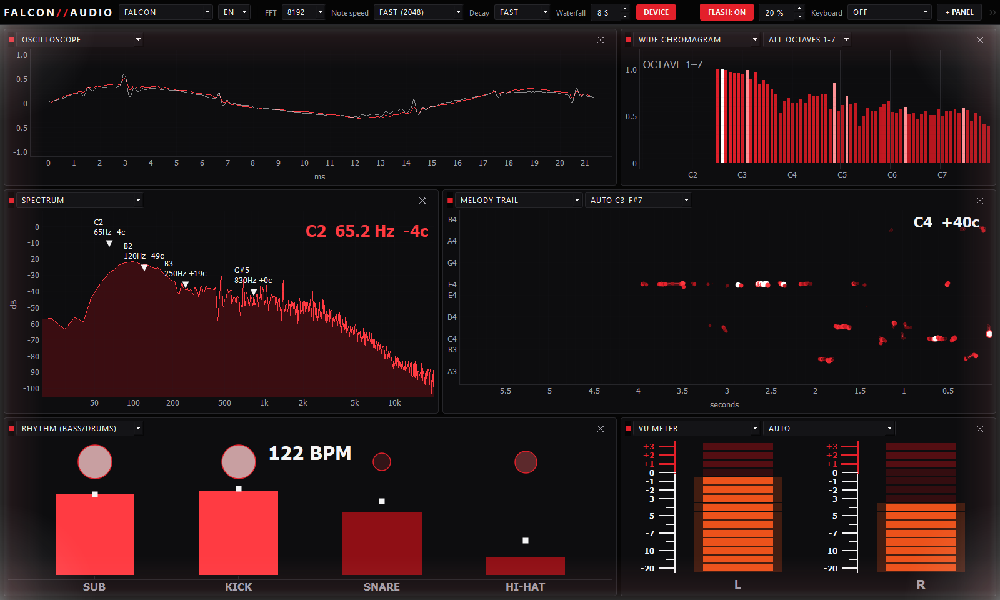
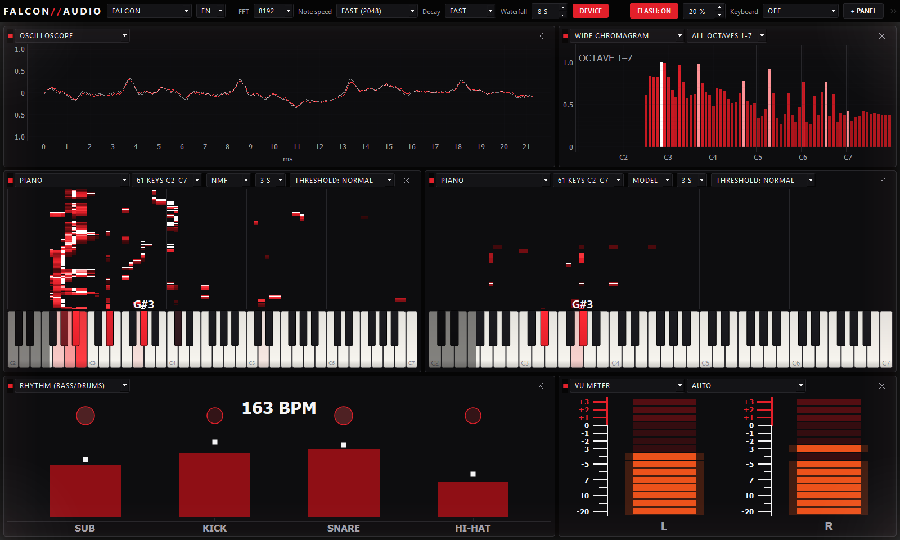
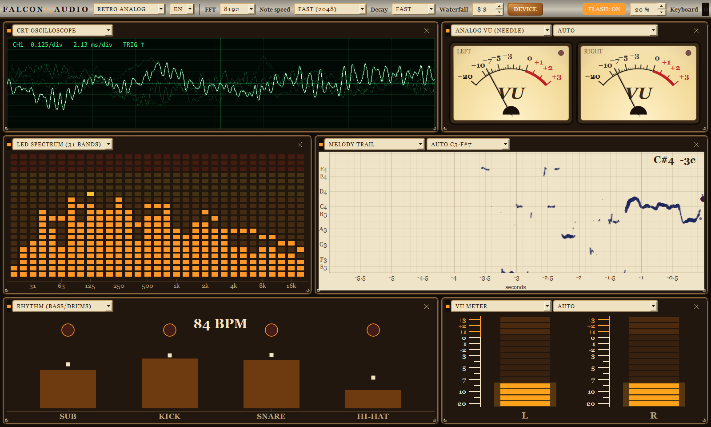
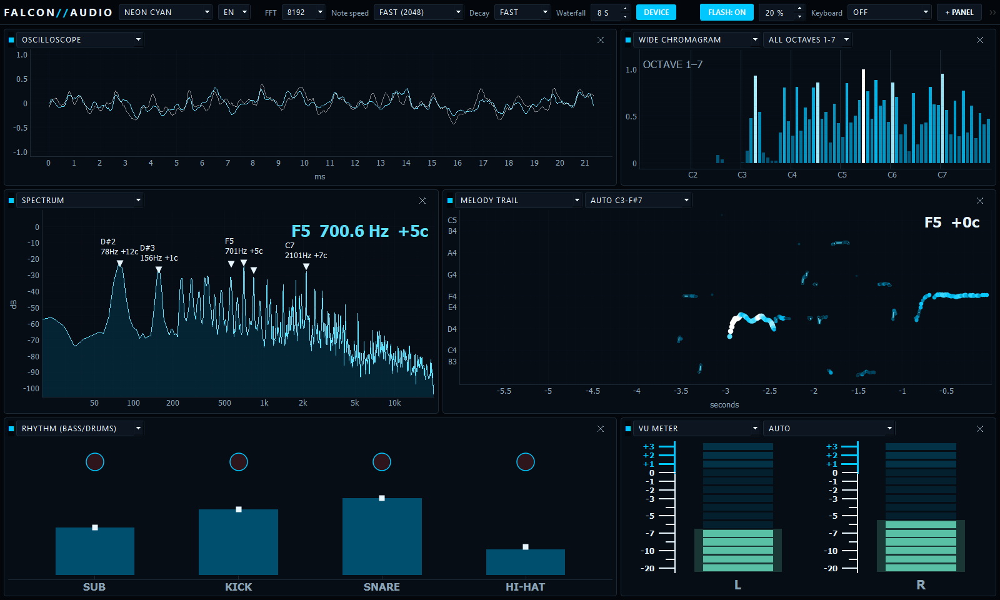
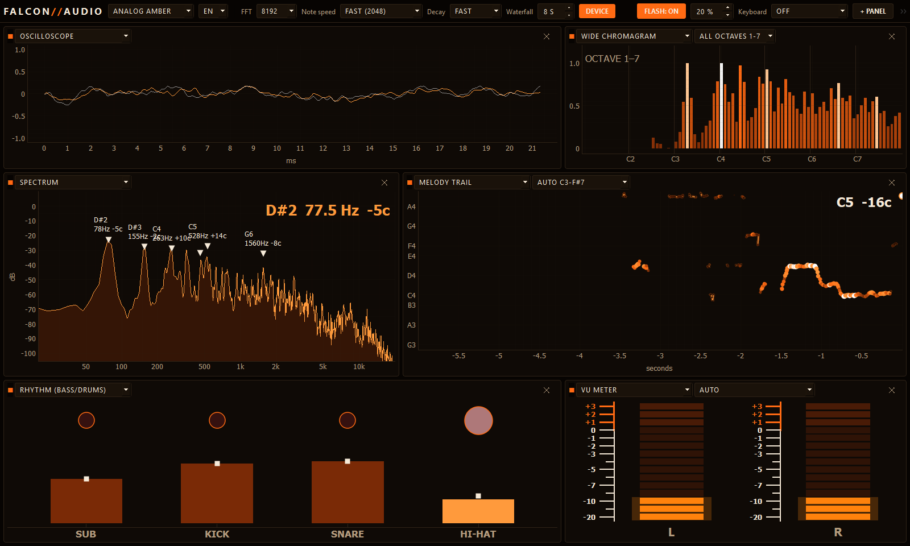
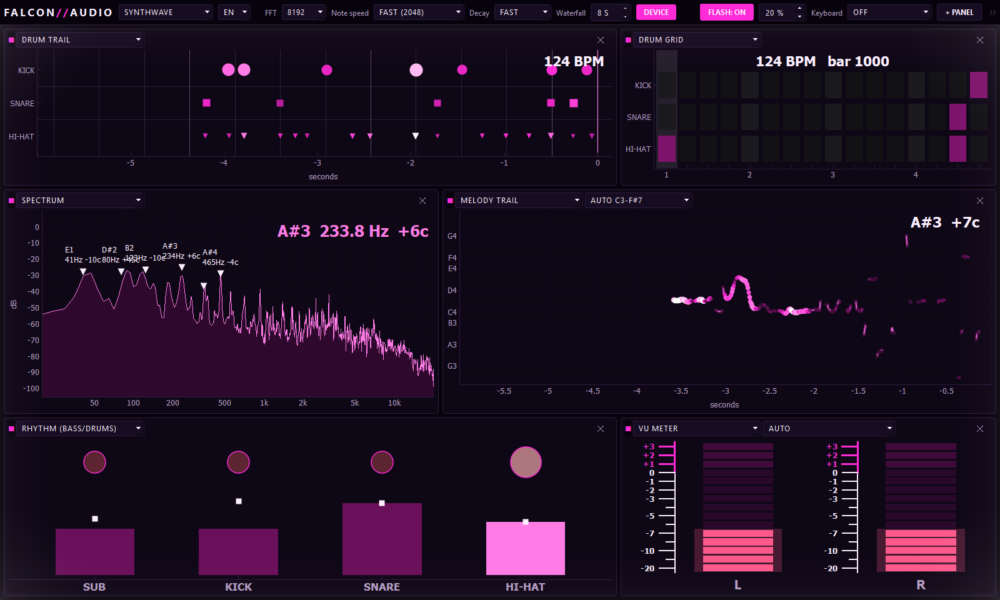

# FALCON//AUDIO

[English](README.md) | **Türkçe**

Bilgisayarda çalan sesi (Spotify, YouTube, oyun… ne çalarsa) ya da mikrofonu **gerçek zamanlı** görselleştiren masaüstü uygulaması. Tek Python dosyası, Windows.



## Özellikler

**20 görünüm.** Ekranda 6 panel var. Her panelin üstündeki menüden görünüm seçilir. Paneller sürüklenerek boyutlandırılır, ✕ ile kapatılır.

| Görünüm | Ne gösterir |
|---|---|
| Osiloskop / CRT Osiloskop | Tetiklemeli dalga şekli. CRT sürümünde yeşil fosfor ve önceki taramaların sönerek kalan izi |
| Spektrum | 20 Hz – 20 kHz, tepe notaları cent hassasiyetiyle işaretli |
| LED Spektrum (31 bant) | Eski hi-fi grafik analizörü: 1/3 oktav, tepe tutmalı LED'ler |
| Waterfall | Zaman-frekans haritası |
| Kromagram / Geniş Kromagram | 12 notanın ağırlığı ve akor tahmini (majör, minör, 7, m7). Geniş sürüm 7 oktavı yan yana gösterir |
| Nota × Oktav | C1–B7 ısı haritası, tepe notalar beyaz |
| Melodi İzi | Saniyede 100 ölçümle baskın perde. Vibrato hızı ve derinliğini gösterir, oktav aralığı panel başına seçilir |
| Oktav Sarmalı / Oktav Enerjisi | Notaların oktav sarmalı üzerinde animasyonu |
| Ritim / Davul Izgarası / Davul İzi | Kick, snare ve hi-hat algılama, BPM, 16 adımlık davul kalıbı ve zaman çizelgesi |
| VU Metre / Analog VU | LED ya da ibreli VU. Referans seviyesi seçilebilir ya da otomatik |
| **Piyano** | Çalan notalar klavyede yanar, üstte piyano rulosu akar. 4 algılama modu (aşağıda), tuş aralığı (37–88 tuş), rulo hızı (1–8 sn) ve tetik eşiği seçilir. Aynı tuşa hızlı tekrar basışlar ayrı ayrı görünür |
| Spotify | Çalan şarkı, kapak, ilerleme ve oynat/durdur/ileri/geri. Kendi Spotify Developer uygulamanın Client ID'si gerekir (aşağıda) |
| Medya | Windows'ta medya çalan her uygulamanın (tarayıcı, YouTube Music, VLC…) şarkı bilgisi ve kontrolleri |
| Pencere Yakalama | Seçilen bir uygulama penceresinin canlı görüntüsü (örn. Spotify'daki video) |

### Piyano algılama modları

| Mod | Nasıl çalışır | Ne zaman |
|---|---|---|
| **NMF** (varsayılan) | Spektrumu notaların harmonik şablonlarının toplamı olarak çözer | Anlık tepki. Sentetik akor testinde F1 0,98 |
| **Model** | Spotify'ın açık kaynak [basic-pitch](https://github.com/spotify/basic-pitch) sinir ağı (ONNX). Son 2 sn sesi saniyede ~12 kez işler | Gerçek kayıtlarda en temiz sonuç, bas notalarını da bulur. İsteğe bağlı kurulum ister |
| Filtre | Harmonikleri eleyen basit tepe filtresi | Hafif |
| Ham | Tüm yarım ton tepeleri | Hata ayıklama |



**Diğer:**
- **Kaldığı yerden açılır:** Pencere boyutu, paneller, her panelin ayarları, tema ve ses cihazı kapanışta (ve 10 saniyede bir) `~/.falcon_audio/state.json` dosyasına kaydedilir. Son cihaz hâlâ bağlıysa açılışta sormadan başlar. Sıfırdan başlamak için bu dosyayı sil.
- **Türkçe / İngilizce arayüz:** Üst çubuktaki TR / EN menüsünden seçilir. Değiştirince uygulama aynı yerleşimle yeniden açılır. İlk açılışta Windows'un diline göre seçilir.
- 6 tema: Falcon, Analog Amber, Neon Cyan, Fosfor Yeşil, Synthwave, **Retro Analog**
- Kick vuruşunda pencere kenarlarında parlama
- **ASUS TUF klavye RGB:** Klavye ışığı kick'e, notaya ya da ses seviyesine tepki verir. Sadece ASUS TUF laptoplarda çalışır, diğer bilgisayarlarda kendini kapatır.

| Retro Analog | Neon Cyan | Analog Amber | Synthwave: davul görünümleri |
|---|---|---|---|
|  |  |  |  |

## Kurulum

Gereken: **Windows 10/11** ve **Python 3.9+**. Bilgisayarda çalan sesi yakalamak için WASAPI loopback kullanıldığından program macOS ve Linux'ta çalışmaz.

```
pip install -r requirements.txt
python scope.py
```

İsteğe bağlı paketler:

```
pip install basic-pitch onnxruntime
pip install winrt-runtime winrt-Windows.Media.Control winrt-Windows.Storage.Streams
```

İlki Piyano panelinin "Model" modu, ikincisi Medya paneli için. Kurulu değilse program yine çalışır, sadece o özellik devre dışı kalır.

İlk açılışta ses kaynağı seçilir. 🔊 işaretliler bilgisayarda çalan ses, 🎤 işaretliler mikrofon. Kaynak sonradan **CİHAZ** düğmesiyle değiştirilebilir.

Tema yazı tipi [Chakra Petch](https://fonts.google.com/specimen/Chakra+Petch) (Google Fonts). Yüklü değilse Segoe UI kullanılır.

### Spotify paneli

1. [developer.spotify.com/dashboard](https://developer.spotify.com/dashboard) adresinde bir uygulama oluştur.
2. Redirect URI olarak `http://127.0.0.1:8888/callback` ekle.
3. Paneldeki giriş düğmesine bas ve **Client ID**'yi yapıştır. Tarayıcıda Spotify'a giriş yapılır. PKCE kullanıldığı için Client Secret gerekmez.

Client ID ve oturum anahtarı sadece kendi bilgisayarında, `~/.falcon_audio/spotify.json` dosyasında tutulur. Bu dosyayı kimseyle paylaşma, repoya da ekleme.

## Bilinen sınırlar

- Melodi ve akor algılama tam bir mikste yaklaşıktır. Vokal ile enstrümanlar karışabilir. Sade vokal ya da solo kayıtlarda daha temiz sonuç verir.
- Piyano "Model" modu yaklaşık 0,1–0,2 sn geriden gelir ve işlemciye ek yük bindirir.
- 170+ BPM'lik şarkılarda tempo yarısı olarak gösterilebilir.
- C1 ile ~D#2 arasındaki notalar FFT çözünürlüğü yetmediği için gösterilmez.
- Klavye RGB özelliği belgelenmemiş bir ASUS arayüzünü kullanır, Armoury Crate ile çakışabilir.

## Test modu

`SCOPE_AUTOTEST=1` ortam değişkeni ayarlıysa program cihaz seçme penceresini atlar ve 5 saniye sonra kendini kapatır. Otomatik testler için kullanılır.
